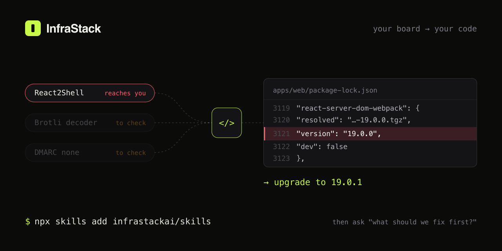

# InfraStack skills



Agent skills from [InfraStack](https://infrastack.ai) for Claude Code, Codex, Cursor, OpenCode and GitHub Copilot.

## infrastack-live

Give your coding agent a security watchdog. It checks the latest threats and your InfraStack board against your repo, and tells you what to fix.

- **Your board, in your editor.** What InfraStack's free scan found on your app (what reaches you, what is left to check), checked against your code with the file and version.
- **Before it adds a package.** It searches the feed for the package and version, and stops a known malicious or vulnerable one.
- **Are we affected?** Ask about any CVE, breach or campaign. It reads the threat's page, checks your lock files and config, and answers yes, no or can't tell.

It reads [InfraStack Live](https://infrastack.ai/live): one markdown page per threat with who is affected, the affected versions, how to check and the fix. Plain HTTPS, no MCP server, no key to copy. Your code never leaves your machine.

### Install

From your repository root:

```sh
npx skills add infrastackai/skills --skill infrastack-live
```

It asks which agents you use; `-a claude-code`, `-a codex`, `-a cursor`, `-a github-copilot` or `-a opencode` picks one directly.

In Claude Code, as a plugin (it can update itself):

```
/plugin install infrastack-live --marketplace infrastackai/skills
```

Or paste one sentence into any agent:

> Read https://infrastack.ai/live/SKILL.md and install it as a skill. Then tell me what to fix first.

To update: `npx skills update infrastack-live`. To remove: `npx skills remove infrastack-live`.

### Sign in once

The first time it reads a page, your agent opens your browser so you can sign in to InfraStack (free) and allow it. It reads as you, and stops the moment you sign it out from your dashboard or leave the workspace. The token stays on your machine and only ever goes to infrastack.ai.

### Then ask

- "What should we fix first?"
- "Are we affected by React2Shell?"
- "Is axios 1.6.0 hit by anything recent?"

### What it reads

- `https://infrastack.ai/api/agent/board.md`: your board (`?status=reach`, `check`, `open`, `closed`)
- `https://infrastack.ai/live.md`: the feed, one line per threat
- `https://infrastack.ai/live/search.md?q=next.js, postgres, stripe`: search several packages at once
- `https://infrastack.ai/live/<id>/threat.md`: one threat, with who is affected, how to check and the fix
- `https://infrastack.ai/live/breaches.md`: last month's breaches by how they happened
- `https://infrastack.ai/llms.txt`: the map of everything

## More

- [infrastack.ai/coding-agents](https://infrastack.ai/coding-agents), with a page each for [Claude Code](https://infrastack.ai/coding-agents/claude-code), [Codex](https://infrastack.ai/coding-agents/codex), [Cursor](https://infrastack.ai/coding-agents/cursor), [Copilot](https://infrastack.ai/coding-agents/copilot) and [OpenCode](https://infrastack.ai/coding-agents/opencode)
- A free account reads 300 pages a day; the Team plan more. The data API and bulk feed: sales@infrastack.ai.
