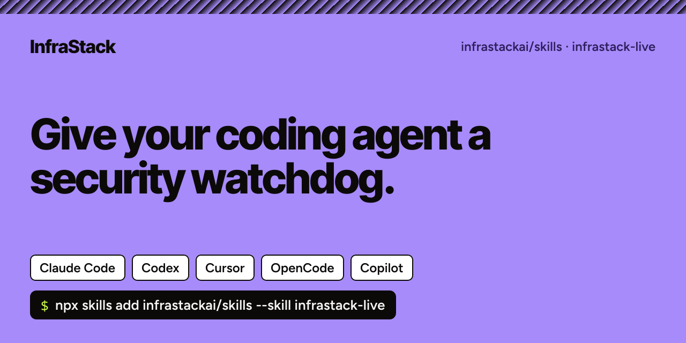

# InfraStack skills



Agent skills from [InfraStack](https://infrastack.ai) for Claude Code, Codex, Cursor, OpenCode and GitHub Copilot.

## infrastack-live

Give your coding agent a security watchdog. It checks the latest CVEs, malicious packages and MCP vulnerabilities against your code, and tells you what's affected, what isn't, and how to fix it. Ask it any time; it usually checks on its own when it adds or upgrades a package, and on a schedule if you set one up.

It reads [InfraStack Live](https://infrastack.ai/live), a free public feed with one markdown page per threat: who is affected, the affected versions, how to check, and the fix. Plain HTTPS. No MCP server, no login, no API key. Your code never leaves your machine; your agent only reads public pages.

### Install

From your repository root:

```sh
npx skills add infrastackai/skills --skill infrastack-live
```

It asks which agents you use. To pick one directly, add `-a`:

| Agent | Command | Saved in |
| --- | --- | --- |
| Claude Code | `npx skills add infrastackai/skills --skill infrastack-live -a claude-code` | `.claude/skills/` |
| Codex | `npx skills add infrastackai/skills --skill infrastack-live -a codex` | `.agents/skills/` |
| Cursor | `npx skills add infrastackai/skills --skill infrastack-live -a cursor` | `.agents/skills/` |
| GitHub Copilot | `npx skills add infrastackai/skills --skill infrastack-live -a github-copilot` | `.agents/skills/` |
| OpenCode | `npx skills add infrastackai/skills --skill infrastack-live -a opencode` | `.agents/skills/` |

To update it later: `npx skills update infrastack-live`. To remove it: `npx skills remove infrastack-live`.

Or paste one sentence into any agent:

> Read https://infrastack.ai/live/SKILL.md and set yourself up with it for this repository.

### Then ask

- "Scan this repo against infrastack.ai/live and tell me which threats hit what we run."
- "Are we affected by React2Shell?"
- "Every morning, check infrastack.ai/live and tell me the day a new threat hits our stack."

### What it reads

- `https://infrastack.ai/live.md`: the feed, one line per threat
- `https://infrastack.ai/live/search.md?q=next.js, postgres, stripe`: search several packages at once
- `https://infrastack.ai/live/<id>/threat.md`: one threat, with who is affected, how to check and the fix
- `https://infrastack.ai/llms.txt`: the map of everything

Every page has a `.json` twin.

## More

- [infrastack.ai/coding-agents](https://infrastack.ai/coding-agents): the skill, the MCP and AI agent threats it knows about, and questions; one page each for [Claude Code](https://infrastack.ai/coding-agents/claude-code), [Codex](https://infrastack.ai/coding-agents/codex), [Cursor](https://infrastack.ai/coding-agents/cursor), [Copilot](https://infrastack.ai/coding-agents/copilot) and [OpenCode](https://infrastack.ai/coding-agents/opencode)
- Alerts without asking, by email or in Slack: [infrastack.ai](https://infrastack.ai)

Free to use, with fair use of about 60 pages a minute. For higher limits or API access: sales@infrastack.ai.
